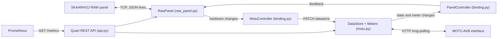

# motu-client

A bridge between a [SKAARHOJ](https://www.skaarhoj.com/) RAW control panel and a MOTU AVB audio interface, with a REST API and Prometheus metrics. The panel's faders, buttons, displays and level meters become a physical mixer surface for the interface's monitor mixes.

## Overview

MOTU AVB interfaces expose their mixer state over an HTTP API, and SKAARHOJ panels can be driven over a plain TCP "RAW panel" protocol. motu-client connects the two. Moving a fader or pressing a button on the panel changes the MOTU mixer, and changes made on the MOTU side (or through the REST API) are reflected back on the panel's fader positions, button lights, displays and level meters.

It is an asyncio service built on [Quart](https://quart.palletsprojects.com/), served by [Hypercorn](https://hypercorn.readthedocs.io/). The MOTU device is followed with HTTP long-polling through [aiohttp](https://docs.aiohttp.org/), and the panel connection is a TCP socket managed by the application.

## Features

- Two-way sync between the panel and the MOTU mixer: panel input is written to the MOTU datastore, and MOTU changes are pushed to the panel
- Faders control aux send levels through a piecewise raw-to-dB mapping that spends most of the fader travel on the -30 dB to +12 dB range
- Mute and solo buttons with lit feedback, plus a monitor override button
- Per-button default send level: pressing the button toggles a send between its default level and unity
- Displays showing the current level in dB
- Level meters with peak hold, in pre-fader or post-fader mode (post-fader meters follow the send level and mute state), updated only when a channel's level or peak changes
- Echo suppression, so a fader position is not sent back to the control that just moved it
- Panel sleep and wake handling: the panel sleep timeout is configured on connect, activity wakes the panel, and the feedback state is re-sent after it wakes up
- Panel connection resilience: TCP keepalive, `TCP_NODELAY`, automatic reconnect and lost-connection handling
- Panel feedback is batched into as few writes as possible
- REST API for reading and changing MOTU mute and aux send state, and for sending raw commands to the panel
- Prometheus HTTP metrics at `/metrics`
- Graceful startup and shutdown: the MOTU session is seeded before the panel connects, and all loops and connections are closed on shutdown
- Multi-stage Docker build with a small Alpine runtime image that runs as a non-root user

## Architecture



The application is wired together in `src/api.py`. At startup it opens the shared HTTP session, loads an initial snapshot of the MOTU datastore and meters, connects to the panel, and starts background tasks for panel I/O, buffered hardware-change processing, and datastore and meter polling.

- `RawPanel` owns the TCP connection to the panel. It parses panel messages, debounces hardware changes, handles reconnects and sleep/wake, and builds the panel's JSON messages.
- `DataStore` and `Meters` long-poll the MOTU's `datastore` and `meters` HTTP endpoints using ETags, and keep a local copy of the state. `DataStore` also writes values back to the device.
- `MotuController` translates panel events into MOTU datastore writes.
- `PanelController` translates MOTU changes into panel feedback: fader positions, button states, display text and meters.
- `mappings.py` holds the static tables that bind panel hardware controls (HWC IDs) to MOTU datastore paths, and MOTU paths to panel feedback.

## Project structure

```text
.
├── Dockerfile                Multi-stage build, runs as a non-root user
├── pyproject.toml            Project metadata and dependencies (uv)
├── uv.lock                   Locked dependencies
├── TODO.md                   Roadmap
└── src/
    ├── api.py                Quart app, REST API, /metrics, startup and shutdown wiring
    ├── binding.py            Controllers, control and feedback maps, raw/dB conversion
    ├── mappings.py           HWC to MOTU path control table and MOTU path to panel feedback table
    ├── motu.py               Async HTTP client, MOTU datastore and meters long-polling
    ├── raw_panel.py          SKAARHOJ RAW panel TCP client and message builders
    └── hypercorn_config.py   Hypercorn settings (log level, startup timeout, log propagation)
```

## Requirements

- A MOTU AVB interface reachable over HTTP on the local network (the code defaults target a MOTU UltraLite-AVB)
- A SKAARHOJ panel with the RAW panel interface enabled, reachable over TCP (port 9923 by default)
- Docker, or Python 3.11+ with [uv](https://docs.astral.sh/uv/)
- Python dependencies (see `pyproject.toml`): aiohttp, aioprometheus[quart], bidict, hypercorn and quart

## Configuration

### Environment variables

| Variable | Default | Description |
| --- | --- | --- |
| `LOG_LEVEL` | `INFO` | One of `CRITICAL`, `ERROR`, `WARNING`, `INFO`, `DEBUG` (case-insensitive). An invalid value falls back to `INFO` with a warning. It is read by both the application and `hypercorn_config.py`. |

### Devices and panel options

The MOTU hostname and the panel connection settings are set where the components are created in `src/api.py`:

```python
motu_ds = motu.DataStore(motu_http_client, "motu.example.local")
motu_ms = motu.Meters(motu_http_client, "motu.example.local")
skaarhoj_panel = raw_panel.RawPanel(
    "panel.example.local",
    delay=0.001,
    sleep_timeout_minutes=10,
)
```

`RawPanel` accepts these keyword arguments:

| Option | Default | Description |
| --- | --- | --- |
| `port` | `9923` | Panel TCP port |
| `delay` | `0.01` | Seconds a hardware change is buffered before it is processed |
| `idle_sleep` | `0.1` | Seconds to wait between checks when no hardware changes are buffered |
| `sleep_timeout_minutes` | `0` | Panel sleep timeout in minutes. `0` leaves the panel's own default. |
| `sleep_mode` | `0` | `0` animates the panel LEDs while asleep, `1` turns the buttons off |
| `sleep_screen_saver` | `0` | Screen saver while asleep: `0` wake up on key press, `1` Sheep And Goats, `2` Save The Oleds, `3` Just Dimmed |
| `panel_brightness_leds` | `4` | LED brightness (0-8) |
| `panel_brightness_oleds` | `2` | OLED brightness (0-8) |
| `panel_dimmed_gain` | `20` | Gain used while the panel is dimmed (1-64, where 64 is full gain) |

The panel layout is defined by two tables in `src/mappings.py`: `control_map` maps panel hardware controls to MOTU datastore paths (with an optional `default_level` and `override_index`), and `feedback_map` maps MOTU paths back to the panel's buttons, faders, displays and meters (`hwcid`, `mode`, `color`, `text`, `channels`, `pre_fader`, `fader_path`, `mute_path` and `audio_meter`).

### Server

Hypercorn is configured through `src/hypercorn_config.py` (`--config file:hypercorn_config.py`), which sets `startup_timeout = 500`, takes the log level from `LOG_LEVEL`, and propagates Hypercorn's loggers to the application's log output.

## Running

### Docker

```bash
docker build -t motu-client .
docker run --rm -p 5000:5000 -e LOG_LEVEL=INFO motu-client
```

The container runs Hypercorn as `hypercorn api:app --bind 0.0.0.0:5000 --config file:hypercorn_config.py` under a non-root user (UID 8888) and exposes port 5000. The MOTU interface and the panel must be reachable from the container.

### Local

```bash
uv sync
cd src
uv run hypercorn api:app --bind 127.0.0.1:5000 --config file:hypercorn_config.py
```

Then open <http://127.0.0.1:5000/>.

## REST API

All endpoints take their arguments as query-string parameters. Responses from the `/api/v1/motu/*` endpoints are JSON of the form `{"status": ...}`.

| Method | Path | Parameters | Description |
| --- | --- | --- | --- |
| `GET` | `/` | | Landing page |
| `POST` | `/api/v1/panel` | `command` | Send a command to the SKAARHOJ panel. Returns `OK`. |
| `GET` | `/api/v1/motu/mute-toggle` | `bus`, `index` | Toggle the mute of a bus channel (`mix/<bus>/<index>/matrix/mute`) and return the new state |
| `GET` | `/api/v1/motu/mute-status` | `bus`, `index` | Read the current mute state of a bus channel |
| `GET` | `/api/v1/motu/aux-send-level` | `chan`, `aux`, optional `format` | Read the send level of an input channel to an aux bus |
| `POST`, `PATCH` | `/api/v1/motu/aux-send-level` | `chan`, `aux`, `value`, optional `format` | Set the send level of an input channel to an aux bus and return the resulting level |

The `format` parameter selects how levels are expressed:

- Omitted: linear gain (the MOTU's native value), limited to the range 0 to +12 dB when setting
- `db`: decibels
- `raw`: the panel's raw fader scale

For example:

```bash
curl "http://127.0.0.1:5000/api/v1/motu/mute-status?bus=chan&index=0"
curl "http://127.0.0.1:5000/api/v1/motu/aux-send-level?chan=0&aux=0&format=db"
curl -X PATCH "http://127.0.0.1:5000/api/v1/motu/aux-send-level?chan=0&aux=0&value=-10&format=db"
```

## Metrics

Prometheus metrics are exposed at `GET /metrics` using the [aioprometheus](https://github.com/claws/aioprometheus) Quart middleware, which tracks HTTP traffic served by the application:

- `requests_total_counter`
- `responses_total_counter`
- `status_codes_counter`
- `exceptions_total_counter`

## Roadmap

Planned and completed work is tracked in [TODO.md](TODO.md).
