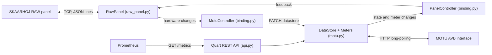

# motu-bridge

A bridge between a [SKAARHOJ](https://www.skaarhoj.com/) RAW control panel and a MOTU AVB audio interface, with a REST API and Prometheus metrics. The panel's faders, buttons, displays and level meters become a physical mixer surface for the interface's monitor mixes.

## Overview

MOTU AVB interfaces expose their mixer state over an HTTP API, and SKAARHOJ panels can be driven over a plain TCP "RAW panel" protocol. motu-bridge connects the two. Moving a fader or pressing a button on the panel changes the MOTU mixer, and changes made on the MOTU side (or through the REST API) are reflected back on the panel's fader positions, button lights, displays and level meters.

It is an asyncio service built on [Quart](https://quart.palletsprojects.com/), served by [Hypercorn](https://hypercorn.readthedocs.io/). The MOTU device is followed with HTTP long-polling through [aiohttp](https://docs.aiohttp.org/), and the panel connection is a TCP socket managed by the application.

## Features

- Two-way sync between the panel and the MOTU mixer: panel input is written to the MOTU datastore, and MOTU changes are pushed to the panel
- Faders control aux send levels through a piecewise raw-to-dB mapping that spends most of the fader travel on the -30 dB to +12 dB range
- Mute and solo buttons with lit feedback, plus a monitor override button
- Per-button default send level: pressing the button toggles a send between its default level and unity
- Displays showing the current level in dB
- Level meters with peak hold, in pre-fader or post-fader mode (post-fader meters follow the send level and mute state), updated only when a channel's level or peak changes
- Echo suppression, so a fader position is not sent back to the control that just moved it
- Panel sleep and wake handling: the panel sleep timeout is configured on connect, activity wakes the panel, and the feedback state is re-sent after it wakes up
- Panel connection resilience: TCP keepalive, `TCP_NODELAY`, automatic reconnect and lost-connection handling
- Panel feedback is batched into as few writes as possible
- REST API for reading and changing every MOTU mixer control, validated against the control specifications published by the interface
- Prometheus HTTP metrics at `/metrics`
- Graceful startup and shutdown: the MOTU session is seeded before the panel connects, and all loops and connections are closed on shutdown
- Multi-stage Docker build with a small Alpine runtime image that runs as a non-root user

## Architecture



The application is wired together in `src/api.py`. At startup it opens the shared HTTP session, loads an initial snapshot of the MOTU datastore and meters, connects to the panel, and starts background tasks for panel I/O, buffered hardware-change processing, and datastore and meter polling.

- `RawPanel` owns the TCP connection to the panel. It parses panel messages, debounces hardware changes, handles reconnects and sleep/wake, and builds the panel's JSON messages.
- `DataStore` and `Meters` long-poll the MOTU's `datastore` and `meters` HTTP endpoints using ETags, and keep a local copy of the state. `DataStore` also writes values back to the device.
- `MotuController` translates panel events into MOTU datastore writes.
- `PanelController` translates MOTU changes into panel feedback: fader positions, button states, display text and meters.
- `settings.py` loads the configuration from environment variables, an optional TOML file and built-in defaults.
- `mappings.py` holds the static tables that bind panel hardware controls (HWC IDs) to MOTU datastore paths, and MOTU paths to panel feedback.

## Project structure

```text
.
├── Dockerfile                Multi-stage build, runs as a non-root user
├── config.example.toml       Commented example configuration file
├── pyproject.toml            Project metadata and dependencies (uv)
├── uv.lock                   Locked dependencies
├── TODO.md                   Roadmap
├── LICENSE                   GNU Affero General Public License v3.0
└── src/
    ├── api.py                Quart app, REST API, /metrics, startup and shutdown wiring
    ├── mixer.py              MOTU mixer controls, value validation and unit conversion
    ├── levels.py             Linear gain and dB conversions
    ├── binding.py            Controllers, control and feedback maps, raw/dB conversion
    ├── mappings.py           HWC to MOTU path control table and MOTU path to panel feedback table
    ├── motu.py               Async HTTP client, MOTU datastore and meters long-polling
    ├── raw_panel.py          SKAARHOJ RAW panel TCP client and message builders
    ├── settings.py           Layered settings (environment, TOML file, defaults)
    └── hypercorn_config.py   Hypercorn settings (bind address, log level, startup timeout, log propagation)
```

## Requirements

- A MOTU AVB interface reachable over HTTP on the local network (the code defaults target a MOTU UltraLite-AVB)
- A SKAARHOJ panel with the RAW panel interface enabled, reachable over TCP (port 9923 by default)
- Docker, or Python 3.11+ with [uv](https://docs.astral.sh/uv/)
- Python dependencies (see `pyproject.toml`): aiohttp, aioprometheus[quart], hypercorn, pydantic, pydantic-settings and quart

## Configuration

Settings are layered. In order of priority, highest first:

1. Environment variables named `MOTU_BRIDGE_<KEY>`, for example `MOTU_BRIDGE_API_PORT`
2. An optional [TOML](https://toml.io/) config file, whose path is set with `MOTU_BRIDGE_CONFIG`
3. Built-in defaults

If `MOTU_BRIDGE_CONFIG` is unset, or the file does not exist, the file layer is skipped. [`config.example.toml`](config.example.toml) lists every key with its default and a comment. Settings are validated at startup, and an invalid value stops the application with a message naming the setting.

Conventions used by the settings:

- A timeout of `0` means no timeout
- A retry count of `-1` means retry forever, and `0` means do not retry
- Intervals are in seconds, and `0` means no wait

### Devices and API

| Environment variable | TOML key | Default | Description |
| --- | --- | --- | --- |
| `MOTU_BRIDGE_MOTU_HOST` | `motu_host` | `ultralite-avb` | MOTU interface host name or IP address |
| `MOTU_BRIDGE_MOTU_PORT` | `motu_port` | `80` | MOTU interface HTTP port |
| `MOTU_BRIDGE_PANEL_HOST` | `panel_host` | `waveboard` | SKAARHOJ panel host name or IP address |
| `MOTU_BRIDGE_PANEL_PORT` | `panel_port` | `9923` | Panel TCP port |
| `MOTU_BRIDGE_API_HOST` | `api_host` | `0.0.0.0` | Address the REST API listens on |
| `MOTU_BRIDGE_API_PORT` | `api_port` | `5000` | Port the REST API listens on |
| `MOTU_BRIDGE_LOG_LEVEL` | `log_level` | `INFO` | `CRITICAL`, `ERROR`, `WARNING`, `INFO` or `DEBUG` (case-insensitive) |

### MOTU connection

| Environment variable | TOML key | Default | Description |
| --- | --- | --- | --- |
| `MOTU_BRIDGE_MOTU_REFRESH_TIMEOUT` | `motu_refresh_timeout` | `15` | Seconds to wait for each refresh request to the MOTU, at startup and in the polling loop. The MOTU holds a long-poll request for about 10 seconds. `0` waits indefinitely. |
| `MOTU_BRIDGE_MOTU_REFRESH_RETRIES` | `motu_refresh_retries` | `-1` | Retries for a failed refresh request to the MOTU, at startup and in the polling loop. `-1` retries forever, so startup waits until the MOTU is reachable. `0` does not retry. |
| `MOTU_BRIDGE_MOTU_MUTATE_TIMEOUT` | `motu_mutate_timeout` | `2` | Seconds to wait for a write to the MOTU to complete. `0` waits indefinitely. |
| `MOTU_BRIDGE_MOTU_MUTATE_RETRIES` | `motu_mutate_retries` | `0` | Retries for a failed write to the MOTU. `0` does not retry, and `-1` retries forever. |
| `MOTU_BRIDGE_MOTU_RETRY_INTERVAL` | `motu_retry_interval` | `10` | Seconds between retries of a failed MOTU request |
| `MOTU_BRIDGE_MOTU_CONNECTOR_LIMIT` | `motu_connector_limit` | `10` | Maximum simultaneous HTTP connections to the MOTU |
| `MOTU_BRIDGE_METERS_IDLE_INTERVAL` | `meters_idle_interval` | `0.2` | Seconds between meter polls while all meters are silent |

### Panel connection

| Environment variable | TOML key | Default | Description |
| --- | --- | --- | --- |
| `MOTU_BRIDGE_PANEL_CONNECT_RETRIES` | `panel_connect_retries` | `20` | Retries of the first panel connection at startup before startup continues. `-1` retries forever, so startup waits until the panel is reachable. `0` does not retry. |
| `MOTU_BRIDGE_PANEL_CONNECT_RETRY_INTERVAL` | `panel_connect_retry_interval` | `10` | Seconds between connection attempts |
| `MOTU_BRIDGE_PANEL_CONNECT_TIMEOUT` | `panel_connect_timeout` | `10` | Seconds to wait for each connection attempt. `0` waits indefinitely. |
| `MOTU_BRIDGE_PANEL_SEND_TIMEOUT` | `panel_send_timeout` | `1` | Seconds to wait for a message to be written to the panel. `0` waits indefinitely. |
| `MOTU_BRIDGE_PANEL_WAKEUP_MIN_INTERVAL` | `panel_wakeup_min_interval` | `10` | Minimum seconds between wake-up commands sent to the panel |

After the first connection attempt, the application keeps reconnecting to the panel in the background whenever the connection is down, with no retry limit.

### Panel behavior

| Environment variable | TOML key | Default | Description |
| --- | --- | --- | --- |
| `MOTU_BRIDGE_PANEL_DELAY` | `panel_delay` | `0.001` | Seconds a hardware change is buffered before it is processed |
| `MOTU_BRIDGE_PANEL_IDLE_SLEEP` | `panel_idle_sleep` | `0.1` | Seconds to wait between checks when no hardware changes are buffered (greater than `0`) |
| `MOTU_BRIDGE_PANEL_SLEEP_TIMEOUT` | `panel_sleep_timeout` | `600` | Panel sleep timeout in seconds. `0` leaves the panel's own default. |
| `MOTU_BRIDGE_PANEL_SLEEP_MODE` | `panel_sleep_mode` | `0` | `0` animates the panel LEDs while asleep, `1` turns the buttons off |
| `MOTU_BRIDGE_PANEL_SLEEP_SCREEN_SAVER` | `panel_sleep_screen_saver` | `0` | Screen saver while asleep: `0` wake up on key press, `1` Sheep And Goats, `2` Save The Oleds, `3` Just Dimmed |
| `MOTU_BRIDGE_PANEL_BRIGHTNESS_LEDS` | `panel_brightness_leds` | `4` | LED brightness (0-8) |
| `MOTU_BRIDGE_PANEL_BRIGHTNESS_OLEDS` | `panel_brightness_oleds` | `2` | OLED brightness (0-8) |
| `MOTU_BRIDGE_PANEL_DIMMED_GAIN` | `panel_dimmed_gain` | `20` | Gain used while the panel is dimmed (0-64, where 64 is full gain and `0` selects the panel's own default) |

### Server

| Environment variable | TOML key | Default | Description |
| --- | --- | --- | --- |
| `MOTU_BRIDGE_STARTUP_TIMEOUT` | `startup_timeout` | `500` | Seconds the server waits for application startup to finish. `0` waits indefinitely. |
| `MOTU_BRIDGE_SHUTDOWN_TIMEOUT` | `shutdown_timeout` | `5` | Seconds background tasks get to finish on shutdown (greater than `0`) |

Hypercorn is configured through `src/hypercorn_config.py` (`--config file:hypercorn_config.py`) and must be started with `python -m hypercorn` from the `src` directory so the settings module is importable. It takes the bind address, startup timeout and log level from the settings above, and propagates Hypercorn's loggers to the application's log output. A `--bind` option on the Hypercorn command line takes precedence over `MOTU_BRIDGE_API_HOST` and `MOTU_BRIDGE_API_PORT`.

### Panel layout

The panel layout is defined by two tables in `src/mappings.py`: `control_map` maps panel hardware controls to MOTU datastore paths (with an optional `default_level` and `override_index`), and `feedback_map` maps MOTU paths back to the panel's buttons, faders, displays and meters (`hwcid`, `mode`, `color`, `text`, `channels`, `pre_fader`, `fader_path`, `mute_path` and `audio_meter`).

## Running

### Docker

```bash
docker build -t motu-bridge .
docker run --rm -p 5000:5000 \
  -e MOTU_BRIDGE_MOTU_HOST=motu.example.local \
  -e MOTU_BRIDGE_PANEL_HOST=panel.example.local \
  motu-bridge
```

The container runs Hypercorn as `python -m hypercorn api:app --config file:hypercorn_config.py` under a non-root user (UID 8888) and exposes port 5000, the default `MOTU_BRIDGE_API_PORT`. If you change the API port, publish that port instead. The MOTU interface and the panel must be reachable from the container.

To use a config file, mount it into the container and point `MOTU_BRIDGE_CONFIG` at it:

```bash
cp config.example.toml config.toml   # edit as needed
docker run --rm -p 5000:5000 \
  -v "$PWD/config.toml:/config/config.toml:ro" \
  -e MOTU_BRIDGE_CONFIG=/config/config.toml \
  motu-bridge
```

The file must be readable by the container user (UID 8888). Environment variables passed with `-e` still override values from the file.

Bare host names such as the default `ultralite-avb` and `waveboard` can resolve on the Docker host but not inside the container. Docker cannot use the host's systemd-resolved stub (`127.0.0.53`), so it falls back to the upstream DNS servers, which often do not include the host's DNS search domain. Compose networks use Docker's embedded DNS (`127.0.0.11`). If the names do not resolve in the container, either:

- Use fully qualified host names (or IP addresses) in `MOTU_BRIDGE_MOTU_HOST` and `MOTU_BRIDGE_PANEL_HOST`, or in the `motu_host` and `panel_host` keys of the config file
- Add the search domain to the container with `dns_search` in the Compose service (`--dns-search` with `docker run`)

```yaml
services:
  motu-bridge:
    dns_search:
      - example.lan
```

### Local

```bash
uv sync
cd src
uv run python -m hypercorn api:app --config file:hypercorn_config.py
```

The API listens on `0.0.0.0:5000` unless configured otherwise. For example, to keep it local and use a config file:

```bash
MOTU_BRIDGE_CONFIG=../config.toml MOTU_BRIDGE_API_HOST=127.0.0.1 uv run python -m hypercorn api:app --config file:hypercorn_config.py
```

Then open <http://127.0.0.1:5000/>.

## REST API

The mixer API mirrors the MOTU datastore: the URL path after `/api/v1/motu/mix/` is the datastore path after `mix/`, for example `chan/0/matrix/mute`, `chan/0/matrix/aux/0/send`, `chan/0/eq/mid1/gain` or `reverb/0/reverb/predelay`. `GET` reads a value. `PUT` sets it, with the new value, and for levels optionally its `format`, as a JSON object in the request body (`Content-Type: application/json`). `POST` toggles an on/off control and takes no body. Every response under `/api/` is JSON, errors included.

| Method | Path | Body | Response |
| --- | --- | --- | --- |
| `GET` | `/` | | Landing page (HTML) |
| `GET` | `/api/v1/motu/mix/<path>?format=<format>` | | `{"value": 0.5, "format": "linear"}` |
| `PUT` | `/api/v1/motu/mix/<path>?format=<format>` | `{"value": -6, "format": "db"}` | `{"value": 0.5, "format": "linear"}` with the value that was applied |
| `POST` | `/api/v1/motu/mix/<path>` | none | `{"value": true}` with the new state after toggling |

Each control is validated against the specification the MOTU publishes for it under `mix/ctrls`:

- On/off controls such as `matrix/mute`, `matrix/solo` or `eq/mid1/enable` take `true` or `false`, and are the only controls `POST` can toggle
- Numeric controls such as `eq/mid1/gain` (dB), `eq/mid1/freq` (Hz) or `comp/attack` (ms) take a number within the control's range
- Choice controls such as `comp/peak` or `eq/lowshelf/mode` take the number of one of the choices
- Levels such as `matrix/fader`, sends such as `matrix/aux/<aux>/send`, `gate/threshold` and `talkback/dim` take a number in the unit given by the body's `format`
- Values without a specification, such as `config/format`, can be read but not changed

Levels can be read and written in any of these formats:

- `linear` (default): linear gain, the MOTU's native value
- `db`: decibels
- `raw-panel`: the panel's fader scale

The `format` field in a `PUT` body sets the unit of `value`. The optional `format` query parameter sets the unit of the response, and defaults to the body's `format` on `PUT`. Both apply to levels only.

When setting a level, the value is limited to the control's maximum, which is 4.0 linear (about +12 dB) for faders and sends, and rounded to the MOTU's resolution of six decimal places, so the lowest level above silence is -120 dB. A level of 0 is silence, which is minus infinity in dB. JSON has no infinity, so in `db` format silence is `null`, both in responses and when setting a level. In `raw-panel` format silence is `0`.

Errors are returned as JSON of the form `{"error": "description"}` with one of these status codes:

- `400`: an invalid value or `format`, a `format` in the query or body on a control that is not a level, a change to a read-only value, a `POST` to a control that is not on/off, or a request body that is not a JSON object with a `value` field
- `404`: the MOTU has no value at the requested path, or the URL does not exist
- `405`: the HTTP method is not supported for the URL
- `502`: the MOTU did not accept a change
- `503`: the MOTU data has not been loaded yet

For example:

```bash
curl http://127.0.0.1:5000/api/v1/motu/mix/chan/0/matrix/mute
curl -X PUT http://127.0.0.1:5000/api/v1/motu/mix/chan/0/matrix/mute -H 'Content-Type: application/json' -d '{"value": true}'
curl -X POST http://127.0.0.1:5000/api/v1/motu/mix/chan/0/matrix/mute
curl "http://127.0.0.1:5000/api/v1/motu/mix/chan/0/matrix/aux/0/send?format=db"
curl -X PUT http://127.0.0.1:5000/api/v1/motu/mix/chan/0/matrix/aux/0/send -H 'Content-Type: application/json' -d '{"value": -10, "format": "db"}'
curl -X PUT "http://127.0.0.1:5000/api/v1/motu/mix/chan/0/matrix/aux/0/send?format=raw-panel" -H 'Content-Type: application/json' -d '{"value": -10, "format": "db"}'
curl -X PUT http://127.0.0.1:5000/api/v1/motu/mix/chan/0/eq/mid1/gain -H 'Content-Type: application/json' -d '{"value": 3.5}'
```

## Metrics

Prometheus metrics are exposed at `GET /metrics` using the [aioprometheus](https://github.com/claws/aioprometheus) Quart middleware, which tracks HTTP traffic served by the application:

- `requests_total_counter`
- `responses_total_counter`
- `status_codes_counter`
- `exceptions_total_counter`

## Roadmap

Planned and completed work is tracked in [TODO.md](TODO.md).

## License

Copyright (C) 2020-present Maxim Yukin

This project is licensed under the GNU Affero General Public License v3.0. See [LICENSE](LICENSE) for the full text. If you run a modified version as a network service, you must offer its source code to the users of that service.
